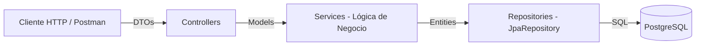
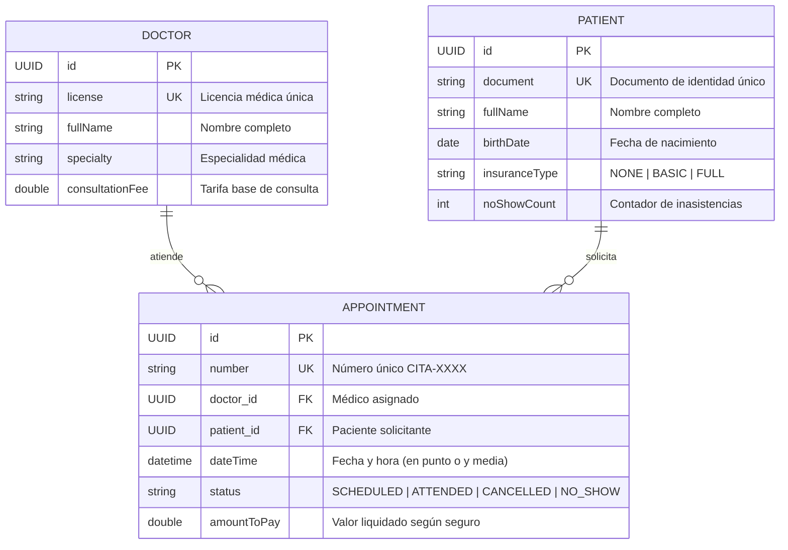
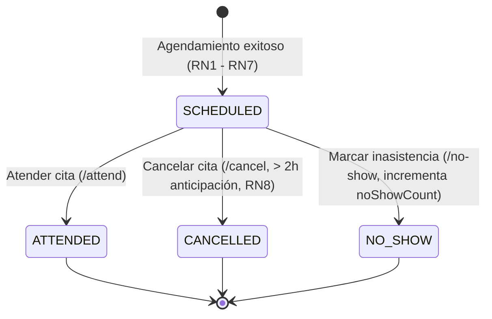

# Sistema de Citas Médicas (`clinica`)

Proyecto final práctico para la asignatura **Desarrollo de Software**.

---

## 1. Arquitectura del Sistema

El proyecto implementa estrictamente una arquitectura en capas desacopladas, siguiendo las reglas establecidas:

1. **El controlador nunca usa entidades:** se comunica exclusivamente mediante DTOs y Modelos de dominio.
2. **La lógica de negocio reside únicamente en la capa de servicios (`<X>Service`).**
3. **No se exponen entidades JPA al controlador:** las entidades (`<X>Entity`) son confinadas a las capas de persistencia y servicio.
4. **Inyección de dependencias por constructor** mediante anotaciones de Lombok (`@RequiredArgsConstructor`).
5. **Mappers estáticos** dedicados para transformaciones bidireccionales: `DTO <-> Model <-> Entity`.
6. **Manejo global de excepciones** centralizado con `@RestControllerAdvice` retornando respuestas de error estructuradas.

```
com.example.clinica
├── controllers/            DoctorController, PatientController, AppointmentController
├── dtos/                   <X>CreateDto, <X>UpdateDto, <X>ResponseDto, ErrorResponseDto
├── models/                 Doctor, Patient, Appointment, InsuranceType, AppointmentStatus
├── entities/               DoctorEntity, PatientEntity, AppointmentEntity
├── mappers/                DoctorMapper, PatientMapper, AppointmentMapper
├── repositories/           DoctorRepository, PatientRepository, AppointmentRepository
├── services/               DoctorService, PatientService, AppointmentService
├── exceptions/             ResourceNotFoundException, ResourceConflictException, 
│                           BusinessValidationException, GlobalExceptionHandler
└── config/
```

### Diagrama de Flujo Arquitectónico



---

## 2. Diagrama Entidad-Relación (ER)



---

## 3. Máquina de Estados de la Cita



* Los estados `ATTENDED`, `CANCELLED` y `NO_SHOW` son **estados finales**. Cualquier intento de transición desde un estado final responderá con código **422 Unprocessable Entity**.
* Al marcar `NO_SHOW`, el contador `noShowCount` del paciente se incrementa automáticamente en 1.

---

## 4. Reglas de Negocio Implementadas

| # | Regla | Validación | Código HTTP de Error |
|---|---|---|---|
| **RN1** | Citas de 30 min y sólo en horas en punto o y media (`:00` o `:30`). | Minuto debe ser `0` o `30`, segundo y nanosegundo en `0`. | `422 Unprocessable Entity` |
| **RN2** | Agendamiento de lunes a viernes de 8:00 a 17:00 (última cita a las 16:30). | Día no fin de semana; hora entre `08:00` y `16:30`. | `422 Unprocessable Entity` |
| **RN3** | No se puede agendar en el pasado. | `dateTime.isBefore(LocalDateTime.now())`. | `422 Unprocessable Entity` |
| **RN4** | Médico no puede tener dos citas `SCHEDULED` en el mismo horario. | Validación en BD con cita programada para el médico. | `409 Conflict` |
| **RN5** | Paciente no puede tener dos citas `SCHEDULED` el mismo día. | Rango de `00:00:00` a `23:59:59` del día seleccionado. | `409 Conflict` |
| **RN6** | Tarifa a pagar según seguro: `NONE` (100%), `BASIC` (50%), `FULL` (0%). | Cálculo automático en el servicio: nunca viene del cliente. | n/a |
| **RN7** | Paciente con 2 o más inasistencias (`NO_SHOW`) no puede agendar. | `patient.getNoShowCount() >= 2`. | `422 Unprocessable Entity` |
| **RN8** | Cancelación sólo permitida con más de 2 horas de anticipación y en `SCHEDULED`. | `Duration.between(now, dateTime) > 120 min` y estado `SCHEDULED`. | `422 Unprocessable Entity` |

---

## 5. Endpoints de la API REST

### Médicos (`/api/doctor`)

| Método | Ruta | Descripción | Respuestas |
|---|---|---|---|
| `GET` | `/api/doctor` | Listar todos los médicos | `200 OK` |
| `GET` | `/api/doctor/{license}` | Consultar médico por licencia | `200 OK`, `404 Not Found` |
| `POST` | `/api/doctor` | Crear nuevo médico | `201 Created`, `400 Bad Request`, `409 Conflict` |
| `PUT` | `/api/doctor/{license}` | Actualizar nombre, especialidad y tarifa | `200 OK`, `400 Bad Request`, `404 Not Found` |
| `DELETE` | `/api/doctor/{license}` | Eliminar médico (falla si tiene citas `SCHEDULED`) | `204 No Content`, `404 Not Found`, `422 Unprocessable` |

### Pacientes (`/api/patient`)

| Método | Ruta | Descripción | Respuestas |
|---|---|---|---|
| `GET` | `/api/patient` | Listar todos los pacientes | `200 OK` |
| `GET` | `/api/patient/{document}` | Consultar paciente por documento | `200 OK`, `404 Not Found` |
| `POST` | `/api/patient` | Crear nuevo paciente | `201 Created`, `400 Bad Request`, `409 Conflict` |
| `PUT` | `/api/patient/{document}` | Actualizar nombre, fecha de nacimiento y seguro | `200 OK`, `400 Bad Request`, `404 Not Found` |
| `DELETE` | `/api/patient/{document}` | Eliminar paciente (falla si tiene citas `SCHEDULED`) | `204 No Content`, `404 Not Found`, `422 Unprocessable` |

### Citas Médicas (`/api/appointment`)

| Método | Ruta | Descripción | Respuestas |
|---|---|---|---|
| `POST` | `/api/appointment` | Agendar nueva cita (RN1 a RN7) | `201 Created`, `400`, `404`, `409`, `422` |
| `GET` | `/api/appointment/{number}` | Consultar cita por número generado | `200 OK`, `404 Not Found` |
| `PATCH` | `/api/appointment/{number}/cancel` | Cancelar cita médica (RN8) | `200 OK`, `404 Not Found`, `422 Unprocessable` |
| `PATCH` | `/api/appointment/{number}/attend` | Marcar cita como atendida | `200 OK`, `404 Not Found`, `422 Unprocessable` |
| `PATCH` | `/api/appointment/{number}/no-show` | Marcar inasistencia e incrementar contador | `200 OK`, `404 Not Found`, `422 Unprocessable` |
| `GET` | `/api/appointment?doctorLicense=&date=` | Citas de un médico en una fecha (`YYYY-MM-DD`) | `200 OK`, `404 Not Found` |
| `GET` | `/api/appointment/patient/{document}` | Historial cronológico de citas de un paciente | `200 OK`, `404 Not Found` |

---

## 6. Formato Estándar de Errores

Todas las excepciones del sistema son capturadas por `GlobalExceptionHandler` y formateadas de forma unificada:

```json
{
  "timestamp": "2026-11-12T10:00:00",
  "status": 409,
  "error": "Conflict",
  "message": "El médico MED-100 ya tiene una cita en ese horario",
  "path": "/api/appointment"
}
```

---

## 7. Configuración y Variables de Entorno

De acuerdo con la rúbrica y las buenas prácticas de seguridad, **no se suben credenciales al repositorio**. Las credenciales de base de datos se leen de variables de entorno en `application.properties`:

```properties
spring.datasource.url=jdbc:postgresql://${DB_HOST:localhost}:${DB_PORT:5432}/${DB_NAME:clinica}
spring.datasource.username=${DB_USER}
spring.datasource.password=${DB_PASSWORD}
```

### Configuración en Windows (PowerShell):

```powershell
$env:DB_USER="postgres"
$env:DB_PASSWORD="root"
```

---

## 8. Ejecución y Pruebas

### Compilar y Ejecutar la Aplicación:
```powershell
cd clinica
.\mvnw spring-boot:run
```

Verificar el estado del servicio:
```
GET http://localhost:8080/actuator/health
Respuesta: {"status": "UP"}
```

### Ejecutar Suite Completa de Pruebas:
```powershell
cd clinica
.\mvnw test
```

### Reporte de Pruebas Unitarias e Integración:
```
[INFO] Results:
[INFO] 
[INFO] Tests run: 63, Failures: 0, Errors: 0, Skipped: 0
[INFO] 
[INFO] ------------------------------------------------------------------------
[INFO] BUILD SUCCESS
[INFO] ------------------------------------------------------------------------
```

* **`AppointmentServiceTest`**: 20 pruebas unitarias cubriendo todas las reglas de negocio (RN1 a RN8), cálculo de liquidación según seguro, validación de estados y consultas.
* **`DoctorServiceTest`**: 8 pruebas unitarias cubriendo CRUD, validación de duplicados y restricción de eliminación con citas agendadas.
* **`PatientServiceTest`**: 8 pruebas unitarias cubriendo CRUD, documentos duplicados y restricción de borrado.
* **`AppointmentControllerTest`**: 10 pruebas MockMvc verificando códigos HTTP (201, 200, 404, 409, 422) y serialización JSON.
* **`DoctorControllerTest`**: 8 pruebas MockMvc.
* **`PatientControllerTest`**: 8 pruebas MockMvc.
* **`ClinicaApplicationTests`**: Prueba de carga de contexto.

---

## 9. Colección de Postman

El repositorio incluye el archivo `clinica_postman_collection.json` Contiene carpetas organizadas:
1. **0. Actuator Health**: Verificación de salud del sistema (`/actuator/health`).
2. **1. Datos Base (Setup)**: Creación del médico `MED-100` y pacientes `P-1` (`NONE`), `P-2` (`BASIC`) y `P-3` (`FULL`).
3. **2. Casos de Referencia Sección 5**: Los 13 casos de prueba obligatorios.
4. **3. CRUD Doctor**: Operaciones completas de médicos.
5. **4. CRUD Patient**: Operaciones completas de pacientes.
6. **5. Operaciones y Consultas de Citas**: Agendamiento, cancelaciones, atención, inasistencias y consultas por médico/paciente.
